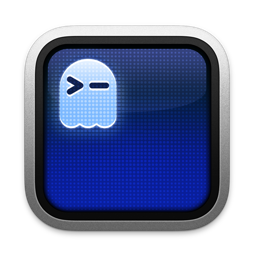

<!-- LOGO -->
<h1>
  <p align="center">
    
    <br />Rustty
  </p>
</h1>
  <p align="center">
    A full-fidelity Rust port of Ghostty — a fast, native, feature-rich
    terminal emulator pushing modern features.
    <br />
    A native GUI or embeddable library via <code>librustty</code>.
  </p>
  <p align="center">
    <a href="https://rustty.sh/porting">
      
    </a>
  </p>
  <p align="center">
    <a href="#about">About</a>
    ·
    <a href="https://rustty.sh/download">Download</a>
    ·
    <a href="https://rustty.sh/docs">Documentation</a>
    ·
    <a href="CONTRIBUTING.md">Contributing</a>
    ·
    <a href="HACKING.md">Developing</a>
  </p>
</p>

> [!NOTE]
>
> Rustty is a full-fidelity Rust port of
> [Ghostty](https://github.com/ghostty-org/ghostty) by Mitchell Hashimoto
> and the Ghostty contributors. The upstream Ghostty project is the source
> of this port; all credit for the original design, architecture, and
> terminal behavior belongs to it. Rustty translates that work faithfully
> into Rust.
>
> The `https://rustty.sh` website is coming soon; links above may not yet
> be live.

## About

Rustty is a terminal emulator that differentiates itself by being
fast, feature-rich, and native. While there are many excellent terminal
emulators available, they all force you to choose between speed,
features, or native UIs. Rustty provides all three.

**`librustty`** is a cross-platform, zero-dependency C and Rust library
for building terminal emulators or utilizing terminal functionality
(such as style parsing). Anyone can use `librustty` to build a terminal
emulator or embed a terminal into their own applications. See the
[`example` directory](example) for examples of using `librustty` in C
and Rust.

Rustty is a faithful port of [Ghostty](https://github.com/ghostty-org/ghostty).
For background on the original project, see
[About Ghostty](https://ghostty.org/docs/about).

## Download

See the [download page](https://rustty.sh/download) on the Rustty
website (coming soon).

## Documentation

See the [documentation](https://rustty.sh/docs) on the Rustty website
(coming soon).

## Contributing and Developing

If you have any ideas, issues, etc. regarding Rustty, or would like to
contribute to Rustty through pull requests, please check out our
["Contributing to Rustty"](CONTRIBUTING.md) document. Those who would like
to get involved with Rustty's development as well should also read the
["Developing Rustty"](HACKING.md) document for more technical details.

## Roadmap and Status

Rustty is a port-in-progress of Ghostty. The original Ghostty is stable
and in use by millions of people and machines daily; Rustty aims to
faithfully reproduce that behavior in Rust.

The high-level ambitious plan for the project, in order:

|  #  | Step                                                    | Status |
| :-: | ------------------------------------------------------- | :----: |
|  1  | Standards-compliant terminal emulation                  |   ✅   |
|  2  | Competitive performance                                 |   ✅   |
|  3  | Rich windowing features -- multi-window, tabbing, panes |   ✅   |
|  4  | Native Platform Experiences                             |   ✅   |
|  5  | Cross-platform `librustty` for Embeddable Terminals     |   ✅   |
|  6  | Rustty-only Terminal Control Sequences                  |   ❌   |

Additional details for each step in the big roadmap below:

#### Standards-Compliant Terminal Emulation

Rustty implements all of the regularly used control sequences and
can run every mainstream terminal program without issue. The ported VT
engine reproduces Ghostty's [comprehensive xterm audit](https://github.com/ghostty-org/ghostty/issues/632)
behavior, comparing against xterm and building a set of conformance
test cases.

In addition to legacy sequences (what you'd call real "terminal" emulation),
Rustty also supports more modern sequences than almost any other terminal
emulator. These features include things like the Kitty graphics protocol,
Kitty image protocol, clipboard sequences, synchronized rendering,
light/dark mode notifications, and many, many more.

We believe Rustty — inheriting Ghostty's engine — is one of the most
compliant and feature-rich terminal emulators available.

Terminal behavior is partially a de jure standard
(i.e. [ECMA-48](https://ecma-international.org/publications-and-standards/standards/ecma-48/))
but mostly a de facto standard as defined by popular terminal emulators
worldwide. Rustty takes the same approach as Ghostty: our behavior is
defined by (1) standards, if available, (2) xterm, if the feature exists,
(3) other popular terminals, in that order. This defines what the Rustty
project views as a "standard."

#### Competitive Performance

Rustty targets the same performance category as the other highest
performing terminal emulators.

"The same performance category" means that Rustty is much faster than
traditional or "slow" terminals and is within an unnoticeable margin of the
well-known "fast" terminals. For example, Ghostty and Alacritty are usually
within a few percentage points of each other on various benchmarks, but are
both something like 100x faster than Terminal.app and iTerm. However, Rustty
is much more feature rich than Alacritty and has a much more native app
experience.

This performance is achieved through high-level architectural decisions and
low-level optimizations carried over from Ghostty. At a high-level, Rustty has
a multi-threaded architecture with a dedicated read thread, write thread, and
render thread per terminal. Our renderer uses OpenGL on Linux and Metal on
macOS. Our read thread has a heavily optimized terminal parser that leverages
CPU-specific SIMD instructions. Etc.

#### Rich Windowing Features

The Mac and Linux (build with GTK) apps support multi-window, tabbing, and
splits with additional features such as tab renaming, coloring, etc. These
features allow for a higher degree of organization and customization than
single-window terminals.

#### Native Platform Experiences

Rustty is a cross-platform terminal emulator but we don't aim for a
least-common-denominator experience. There is a large, shared core written
in Rust but we do a lot of platform-native things:

- The macOS app is a true SwiftUI-based application with all the things you
  would expect such as real windowing, menu bars, a settings GUI, etc.
- macOS uses a true Metal renderer with CoreText for font discovery.
- macOS supports AppleScript, Apple Shortcuts (AppIntents), etc.
- The Linux app is built with GTK.
- The Linux app integrates deeply with systemd if available for things
  like always-on, new windows in a single instance, cgroup isolation, etc.

Our goal with Rustty is for users of whatever platform they run Rustty
on to think that Rustty was built for their platform first and maybe even
exclusively. We want Rustty to feel like a native app on every platform,
for the best definition of "native" on each platform.

#### Cross-platform `librustty` for Embeddable Terminals

In addition to being a standalone terminal emulator, Rustty is a
C-compatible library for embedding a fast, feature-rich terminal emulator
in any 3rd party project. This library is called `librustty`.

Due to the scope of this project, we're breaking librustty down into
separate libraries, starting with `librustty-vt`. The goal of
this project is to focus on parsing terminal sequences and maintaining
terminal state. This mirrors Ghostty's own `libghostty-vt` effort,
covered in more detail in this
[blog post](https://mitchellh.com/writing/libghostty-is-coming).

`librustty-vt` is a faithful Rust port of Ghostty's `libghostty-vt` and
is usable for Rust and C, compatible with macOS, Linux, Windows, and
WebAssembly. The underlying functionality is extremely stable (since it's
been proven in Ghostty for a long time), but the API signatures are still
in flux.

See the [`example`](example) directory for small examples of using
`librustty` in C and Rust.

We haven't tagged librustty with a version yet and we're still working
on a better docs experience.

#### Rustty-only Terminal Control Sequences

We want and believe that terminal applications can and should be able
to do so much more. We've worked hard to support a wide variety of modern
sequences created by other terminal emulators towards this end, but we also
want to fill the gaps by creating our own sequences.

We've been hesitant to do this up until now because we don't want to create
more fragmentation in the terminal ecosystem by creating sequences that only
work in Rustty. But, we do want to balance that with the desire to push the
terminal forward with stagnant standards and the slow pace of change in the
terminal ecosystem.

We haven't done any of this yet.

## Crash Reports

Rustty has a built-in crash reporter that will generate and save crash
reports to disk. The crash reports are saved to the `$XDG_STATE_HOME/rustty/crash`
directory. If `$XDG_STATE_HOME` is not set, the default is `~/.local/state`.
**Crash reports are _not_ automatically sent anywhere off your machine.**

Crash reports are only generated the next time Rustty is started after a
crash. If Rustty crashes and you want to generate a crash report, you must
restart Rustty at least once. You should see a message in the log that a
crash report was generated.

> [!NOTE]
>
> Use the `rustty +crash-report` CLI command to get a list of available crash
> reports. A future version of Rustty will make the contents of the crash
> reports more easily viewable through the CLI and GUI.

Crash reports end in the `.rusttycrash` extension. The crash reports are in
[Sentry envelope format](https://develop.sentry.dev/sdk/envelopes/). You can
upload these to your own Sentry account to view their contents, but the format
is also publicly documented so any other available tools can also be used.
The `rustty +crash-report` CLI command can be used to list any crash reports.
A future version of Rustty will show you the contents of the crash report
directly in the terminal.

To send the crash report to the Rustty project, you can use the following
CLI command using the [Sentry CLI](https://docs.sentry.io/cli/installation/):

```shell-session
SENTRY_DSN=https://24e331c00d878441594227ff2b6d9688@o4511742589140992.ingest.us.sentry.io/4511742596677632 sentry-cli send-envelope --raw <path to rustty crash>
```

> [!WARNING]
>
> The crash report can contain sensitive information. The report doesn't
> purposely contain sensitive information, but it does contain the full
> stack memory of each thread at the time of the crash. This information
> is used to rebuild the stack trace but can also contain sensitive data
> depending on when the crash occurred.
